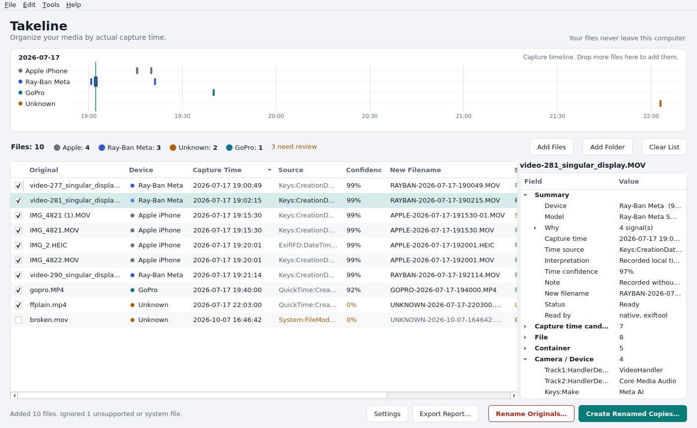

# Takeline for Windows

Rename photos and videos by the moment they were actually recorded, and by the camera that recorded them.

```
video-277_singular_display.MOV  ->  RAYBAN-2026-07-17-190049.MOV
IMG_4821.MOV                    ->  APPLE-2026-07-17-191530.MOV
```

Ray-Ban Meta glasses export clips with names like `video-277_singular_display.MOV`. Drop a batch of them into a video editor next to iPhone B-roll and the order is scrambled. Takeline reads the capture date stored *inside* each file (not Windows' "Date created/modified", which reflect copying and syncing), works out which device made it, and gives every file a name that sorts chronologically. A mixed-camera folder becomes one timeline.

Takeline is an independent implementation; it contains no code from any other application.



**Your files never leave this computer.** There is no network code: no uploads, no analytics, no telemetry.

---

## Getting the app

End users only need `Takeline.exe`: double-click it. No Python, FFmpeg, ExifTool or command line. Windows 10 and 11.

To produce that exe, pick one:

1. **GitHub (no local setup).** Push this folder to a GitHub repository, open **Actions → Build Windows app → Run workflow**, then download `Takeline-x64` from the run's artifacts. Tick *Bundle ExifTool* if you want it included.
2. **On a Windows PC.** Install Python 3.10+ (64-bit, from python.org), then double-click **`build_windows.bat`**. It creates a private virtual environment, runs the tests and writes `dist\Takeline.exe`. Use `build_windows.bat -WithExifTool` to bundle ExifTool. If [Inno Setup 6](https://jrsoftware.org/isinfo.php) is installed it also writes `dist\Takeline-Setup.exe`.
3. **Run from source** (developers): after step 2 has created `.venv`, `run_dev.bat`, or `python -m takeline` with `PYTHONPATH=src`.

**ARM64.** The x64 exe runs on Windows 11 on ARM through emulation. The GitHub workflow also attempts a native ARM64 build (`Takeline-arm64`, marked experimental because it depends on PySide6 publishing Windows-ARM64 wheels for the pinned version).

**SmartScreen / antivirus.** Unsigned PyInstaller executables sometimes trigger "Windows protected your PC" or antivirus false positives. Signing the exe with a code-signing certificate (`signtool sign ...`) resolves this for distribution. UPX compression is disabled because it makes false positives more likely.

---

## Using it

1. Drop files or folders onto the window, or use **Select Files / Select Folder**. Subfolders are included (configurable). Unsupported files, macOS `._` files and `Thumbs.db` are skipped.
2. Takeline reads every file and shows a **preview**. Nothing on disk changes at this point.
   - The timeline strip shows one lane per camera, so you can see how Ray-Ban and iPhone clips interleave. Click a tick to select that file.
   - The table: *Original, Device, Capture Time, Source, Confidence, New Filename, Status*. It is sorted by capture time and every column sorts. Hover any cell to see why a value was chosen.
   - The inspector on the right shows all metadata found in the selected file, grouped into File, Container, Camera / Device, Dates, QuickTime, EXIF, XMP, IPTC and Other, plus every candidate timestamp and how it was interpreted.
3. Fix anything that needs it: right-click → **Set Device** (Auto, Ray-Ban Meta, Apple, Sony, Canon, DJI, GoPro, Unknown, Custom…) or **Capture Time → Choose manually…**. Uncheck files to leave them out. The new name updates immediately.
4. Choose an action:
   - **Create Renamed Copies…**: copies into a folder you choose. Originals are untouched.
   - **Rename Originals…**: renames in place after a confirmation you must tick. An undo record is written first; **Tools → Undo Last Rename** restores the previous names.
5. A summary follows (files processed, errors, collisions resolved). **Export Report…** saves CSV, JSON or text.

Status colours: green is ready; amber needs review (unknown device, filesystem-date fallback, likely duplicate, embedded dates that disagree); red could not be read and is excluded until you set its time manually.

**Developer mode** (Settings) adds **Show Raw Metadata**: every field read, the detector signals and the full timestamp reasoning as JSON, ready to copy or save when adding support for a new camera.

---

## How it works

### Metadata extraction

`src/takeline/metadata/` contains native readers that only read headers and metadata boxes, never the media data, so multi-gigabyte clips are quick and nothing is decoded. The format is identified from file content, not the extension (an iPhone HEIC saved as `.jpg` is still read correctly).

| Format | What is read |
|---|---|
| MOV / MP4 / M4V | movie, track and media headers (`QuickTime:CreateDate`, `Track1:MediaCreateDate`…), QuickTime **Keys** (`mdta`) and **ItemList** (`mdir`) metadata, **UserData** atoms (©mak, ©mod, ©day, FIRM…), XMP, Sony XML (`XML:CreationDateValue`, `XML:DeviceManufacturer`), Canon metadata box, codecs, resolution, duration |
| HEIC / HEIF | EXIF and XMP items via the item location table, image size |
| JPEG / TIFF / PNG | EXIF (IFD0, ExifIFD, GPS, maker-note type incl. Apple maker notes), XMP, IPTC, PNG text chunks |
| AVI | IDIT capture date, INFO list |
| MKV / WebM | DateUTC, muxing/writing app, tags |

Tag names follow ExifTool's group naming (`Keys:CreationDate`, `ExifIFD:DateTimeOriginal`), so output can be compared with ExifTool directly. If an ExifTool executable is bundled (`vendor/exiftool/exiftool.exe`), it runs locally as a persistent process and adds tags the native readers don't decode. Native values always win on conflicts, so results never depend on whether ExifTool is present. A corrupted file produces a per-file error; it never stops the batch.

### Device detection

`src/takeline/detection/` holds one detector per manufacturer: `RayBanDetector`, `AppleDetector`, `SonyDetector`, `CanonDetector`, `DJIDetector`, `GoProDetector`, plus a `GenericDetector`. Each returns weighted signals. Signals combine with a noisy-OR (two independent strong signals beat either alone) and the result is capped at 99%, because metadata can be edited. The engine picks the best detector above the threshold (60% by default). It lowers confidence and says so when two brands both match strongly, and returns **UNKNOWN with an explanation** otherwise. A container type, extension or filename is never enough on its own.

**Ray-Ban Meta.** Deliberately tolerant of new models and renamed apps:

| Signal | Weight |
|---|---|
| Make or Model mentions Ray-Ban (`Ray-Ban Meta Smart Glasses`, `Ray-Ban Stories`, `Meta Ray-Ban Display`…) | 0.90 |
| Make names Meta (`Meta AI`, `Meta`, `Meta Platforms, Inc.`) | 0.85 |
| Model names Meta glasses | 0.80 |
| Model says "smart glasses" without a brand | 0.50 |
| A Keys entry in a Meta namespace (`com.meta.…`) | 0.50 |
| Software/encoder names Meta View / Meta AI | 0.45 |
| Ray-Ban/Meta mentioned in another field | 0.30–0.40 |
| Filename in the Meta app export style (`video-277_singular_display.MOV`) | 0.25, never sufficient alone |

Example preview reasoning: *Keys:Model = Ray-Ban Meta Smart Glasses; Keys:Make = Meta AI; Keys:CreationDate found → Ray-Ban Meta, 99%.* Oakley Meta models are labelled `OAKLEY` rather than mislabelled as Ray-Ban.

**Apple.** Strong evidence is Make = Apple, Model = iPhone/iPad/iPod (or Mac → "Apple device"), Apple maker notes, or an iPhone lens description. Apple camera-capture keys (`LocationAccuracyHorizontal`, `ContentIdentifier`, live-photo keys) are moderate support. Generic QuickTime keys such as `com.apple.quicktime.creationdate` are *not* evidence: other devices use Apple's key namespace too. If Make names another brand, Apple's weak signals are capped. An iPhone clip is never called RAYBAN because it is a MOV.

**Others.** Sony (Make, model naming like ILCE-/ZV-, XAVC brand, NRT XML), Canon (Make/Model, `CanonAVC` compressor, Canon box), DJI (Make, drone-dji XMP, `DJI` in encoder/handler), GoPro (handler `GoPro AVC`, firmware format `HD9.01…`/`H21.01…`, GPMF atom). The generic detector labels any other declared manufacturer from its Make (SAMSUNG, GOOGLE, NIKON, …), or ANDROID when only an Android version is recorded. Files that only carry editing software (Lavf, HandBrake, Premiere…) are UNKNOWN with "the file looks re-encoded".

### Capture-time selection

`src/takeline/timestamps/` holds `CaptureTimestampResolver`, kept separate from detection. It collects every date in the file, discards invalid ones (zero dates, 1904/1970 epochs, "clock not set" placeholders, future dates), and ranks the rest:

| Tier | Sources |
|---|---|
| 1 | Device-specific capture time from the device profile: `Keys:CreationDate` for Ray-Ban Meta and iPhone video, `ExifIFD:DateTimeOriginal` for photos, Sony `XML:CreationDateValue` |
| 2 | Original-capture fields: `Keys:CreationDate`, `ExifIFD:DateTimeOriginal` (+ `OffsetTimeOriginal`), XMP `exif:DateTimeOriginal`, AVI IDIT |
| 3 | Manufacturer-specific capture fields |
| 4 | Other embedded dates: QuickTime movie/track/media headers, XMP/IPTC creation dates, ©day, Matroska, PNG, GPS |
| 5 | A camera-style date in the filename (`IMG_20260717_190049`, `PXL_…`, `DJI_…`), EXIF ModifyDate |
| 6 | Filesystem modified time: last resort only, flagged amber |

It cross-checks the winner against the other sources ("Confirmed by: QuickTime movie header…"), flags embedded dates that disagree by more than a day and lowers confidence. The UI shows which field was used and how it was interpreted.

### Timezones

Three kinds of embedded times exist, and each is handled differently:

- **With an offset** (iPhone `2026-07-17T19:15:30-0300`, EXIF with OffsetTimeOriginal): the local time at the recording location is known exactly.
- **UTC by specification** (QuickTime movie/track headers, Matroska, GPS): converted for display.
- **No timezone** (some cameras' creation dates, EXIF without offset): the camera's clock reading. It is **never shifted**. When a UTC header is also present, the preview notes the implied offset ("the UTC movie header implies the camera clock was at UTC−03:00") as a cross-check.

Settings → Timezone:

- **Automatic** (default): keeps each recorded local time exactly as recorded, and shows UTC-only values in this computer's timezone.
- **System timezone**: converts every value with a known timezone into this computer's timezone.
- **Manual** (e.g. `America/Sao_Paulo`): the same, using a zone you choose. Pick the zone where the footage was *recorded*. Daylight-saving rules are applied for the capture date, not today's date.
- **Treat capture times without a timezone as UTC**: off by default. Turn it on only for a camera known to write UTC unmarked.

**Device profiles.** Some cameras write local time into the QuickTime header, which the spec defines as UTC. The defaults treat **GoPro and Canon** headers as local time and everyone else as UTC. These defaults reflect common knowledge of those cameras and have not been verified against your own files. If a camera's times are off by your UTC offset, change its profile in `settings.json` (see `config/takeline.sample.json`).

### Naming and collisions

`src/takeline/naming/` renders names from the template `{DEVICE}-{YYYY}-{MM}-{DD}-{HH}{MIN}{SEC}{SUFFIX}.{EXT}`.

- Other tokens: `{MODEL}`, `{YY}`, `{YYYYMMDD}`, `{HHMMSS}`, `{ORIGINAL}`. For example `{DEVICE}_{YYYYMMDD}_{HHMMSS}` gives `SONY_20260717_193015.MP4`.
- The extension is preserved as-is by default.
- Names are made Windows-safe: invalid characters and reserved names such as `CON` are handled.

The planner guarantees the following:

- **Unique names.** No two files get the same name in a folder. Comparison is case-insensitive, as on NTFS. Same device and same second gives `…-190049.MOV`, `…-190049-01.MOV`, `…-190049-02.MOV`.
- **Deterministic suffixes.** Suffixes follow capture time, then the original name.
- **No clash with existing files.** A planned name never matches a file already in the target folder.
- **Rename is idempotent.** Running Rename Originals again on a renamed folder changes nothing.
- **Mixed extensions.** `.MOV` and `.JPG` with the same timestamp don't collide.
- **Duplicates.** Files with identical size and identical first/last MiB are flagged as likely duplicates and are never merged or deleted.

### Safety

`src/takeline/operations/executor.py` is the only module that writes to disk.

- **Copies.** A copy can never overwrite: files are opened with exclusive create. Each copy is size-verified and keeps the original timestamps; a failed copy leaves no partial file.
- **Renames.** Chains and swaps (A→B while B→A) are handled without overwriting; a temporary name is used only for true cycles. A target held by a file outside the batch is an error for that file only.
- **Undo.** The undo record (`%APPDATA%\Takeline\history\`) is written before the first rename and kept current during the batch. Undo only reverts files that batch actually renamed, and never overwrites.
- **Batches.** A file that fails (locked, permission denied, vanished, disk full) is reported, and the rest of the batch continues.

---

## Adding a camera manufacturer

1. Create a detector, e.g. `src/takeline/detection/insta360.py`:

```python
from .base import DetectionContext, DeviceDetector, Signal, rx

class Insta360Detector(DeviceDetector):
    code = "INSTA360"                       # used in filenames
    display_name = "Insta360"
    make_pattern = rx(r"^\s*(insta360|arashi vision)")

    def signals(self, ctx: DetectionContext) -> list[Signal]:
        s = []
        for q, v in ctx.makes:              # every Make-like field from every group
            if self.make_pattern.search(v):
                s.append(Signal(0.90, f"{q} = {v}"))
        for q, v in ctx.models:
            if v.upper().startswith(("ONE X", "X3", "X4", "GO 3")):
                s.append(Signal(0.60, f"{q} = {v}"))
        return s
```

2. Register it in `default_detectors()` in `src/takeline/detection/__init__.py`, and optionally in `DEVICE_CHOICES` for the override menu and `DEVICE_COLORS` in `gui/style.py`.
3. If its timestamps need special handling, add a profile in `DEFAULT_PROFILES` (`timestamps/resolver.py`) or in `settings.json`, e.g. `"INSTA360": {"preferred": ["ExifIFD:DateTimeOriginal"], "quicktime_header_local": true}`.
4. Check real files with `python -m takeline inspect FILE` and add a real-sample test (below).

---

## Testing

```
python -m pytest                    # 68 tests
```

Coverage includes:

- **Parsers:** QuickTime keys/headers, moov-after-mdat, 64-bit boxes, UserData/ItemList, Sony XML, HEIC Exif items, JPEG/PNG/AVI/WebM, content sniffing, and corrupted/truncated/malformed files (which must never raise).
- **Detection:** Ray-Ban across model variants, Oakley, iPhone vs Ray-Ban, re-encoded → UNKNOWN, filename hints never sufficient, conflicts, threshold.
- **Timestamps:** priorities, timezone modes, DST at the capture date, the GoPro profile, filename/filesystem fallback, disagreement flags.
- **Naming and planning:** suffixes, case-insensitivity, existing files, idempotency, duplicates.
- **File operations:** no-overwrite copy, swap cycles, foreign blockers, safe undo.
- **End to end:** the acceptance scenario (with deliberately wrong filesystem dates), copy then rename, 1,500 same-second files, and a GUI smoke test.

**About the fixtures.** `tests/builders.py` writes *synthetic* files with correct container structures; `test_exiftool_crosscheck.py` confirms ExifTool reads them identically. Their metadata values (e.g. Make `Meta AI`, Model `Ray-Ban Meta Smart Glasses`) follow the product brief. They are **not** captures from real glasses and are not proof of what real devices write.

**Real files.** Put real samples in `tests/real_samples/` with a sidecar `<file>.expected.json`, e.g. `{"device": "RAYBAN", "capture_time": "2026-07-17 19:00:49"}`, and run `python -m pytest tests/test_real_samples.py -v`. To see exactly what Takeline reads and why:

```
python -m takeline inspect "D:\Clips\video-277_singular_display.MOV"
python -m takeline scan "D:\Clips"            # dry-run preview table, changes nothing
```

(The developer CLI runs from source; the packaged exe is the windowed app.)

---

## Project layout

```
src/takeline/
  metadata/      record.py (grouped tag store), quicktime.py (MOV/MP4/HEIF), exif.py (EXIF/IPTC/JPEG),
                 xmp.py, containers.py (PNG/TIFF/AVI/MKV), exiftool_backend.py, extractor.py
  detection/     base.py (DeviceDetector, signals), rayban.py, apple.py, cameras.py, engine.py
  timestamps/    parsing.py, timezone.py (TimezonePolicy), resolver.py (CaptureTimestampResolver)
  naming/        template.py (FilenameTemplate), planner.py (collision-safe planning, duplicates)
  operations/    executor.py (copy/rename/undo), report.py (summary, CSV/JSON/TXT export)
  pipeline.py    scan -> extract -> detect -> resolve -> plan (the dry run)
  gui/           main_window.py, timeline.py, table_model.py, inspector.py, dialogs.py, style.py
  app.py, cli.py, config.py
tests/           pytest suite + builders + real_samples/
takeline.spec, build_windows.bat/.ps1, installer/Takeline.iss, .github/workflows/build-windows.yml
config/takeline.sample.json
```

## Known limitations

- Ray-Ban Meta detection is based on the identifiers in the brief. Please verify it with your own clips: `tests/real_samples` makes that a one-minute check.
- GoPro/Canon header-time handling uses best-known defaults (configurable, see *Device profiles*).
- MPEG-TS/AVCHD (`.MTS`), RAW formats other than DNG/TIFF, and Insta360 `.insv` are not in the supported list yet.
- MKV/WebM files rarely carry a real capture date; most will fall back to the filename or filesystem date and be flagged for review.

Third-party components and their licenses are listed in [THIRD-PARTY-NOTICES.md](THIRD-PARTY-NOTICES.md) (also under Help → Third-Party Licenses in the app). Settings from earlier versions named CaptureSort are migrated automatically.
